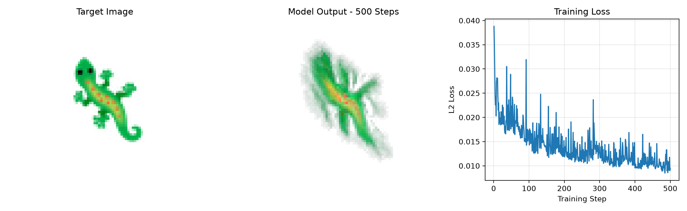
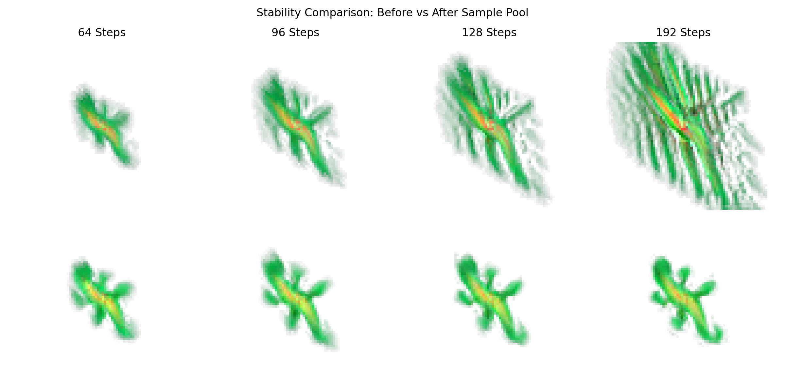
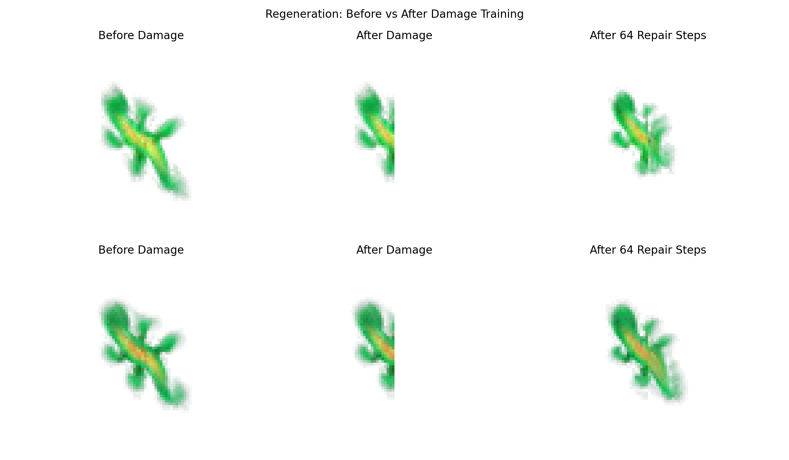

# Growing Neural Cellular Automata

This project is a PyTorch implementation of the paper [Growing Neural Cellular Automata: A Differentiable Model of Morphogenesis](https://distill.pub/2020/growing-ca/), published in 2020.

The goal is to study how a neural cellular automaton can grow an image from a single cell, keep the image stable, and repair damaged parts.

The project focuses on three experiments: image growth, stability, and regeneration.

## 1. Model Architecture

The model uses a grid of cells. Each cell has 16 channels:

- 3 channels for RGB colors
- 1 alpha channel to identify living cells
- 12 hidden channels for additional information

Each cell receives information from nearby cells using Sobel filters. This gives 48 input values.

A small neural network processes these values:

**48 → 128 → ReLU → 16**

The network calculates changes to the cell state. Each cell has a 50% chance of being updated at each step.

An alive mask is used to keep living cells and their neighbors active and remove cells outside these areas.

All cells use the same neural network and the same weights.

Our implementation uses a 72 × 72 grid.

## 2. Experiments

### Experiment 1: Learning to Grow

The first experiment trains the model to grow a green lizard image from a single seed cell.

During training, the model runs for a random number of CA steps between 64 and 96.

We trained the model for 500 training steps.

The loss decreased from approximately 0.0388 to 0.0095.

The model learned to produce a shape similar to the target image, but the result was still slightly blurry.

### Experiment 2: Stability

The second experiment focuses on keeping the generated image stable over time.

We used a sample pool with 1,024 cell states and continued training the model for 500 steps.

We compared the original model and the sample pool model after 64, 96, 128, and 192 CA steps.

The sample pool model showed better stability over longer growth periods.

### Experiment 3: Regeneration

The third experiment focuses on repairing damaged images.

We continued training the model using a sample pool. During training, random circular areas were removed from selected cell states.

To evaluate regeneration, we first grew the image for 96 steps. Then, we removed the right half of the cell state and allowed the model to run for another 64 steps.

The regeneration model achieved a lower repair loss than the sample pool model in our comparison.

## 3. Project Structure

| File or Folder | Description |
|---|---|
| `nca_model.py` | Neural Cellular Automata model |
| `train_growth.py` | Training for image growth |
| `train_stability.py` | Training with a sample pool |
| `train_regeneration.py` | Training with damaged cell states |
| `compare_stability.py` | Stability evaluation |
| `compare_regeneration.py` | Regeneration evaluation |
| `data/` | Target images |
| `models/` | Trained model weights |
| `results/` | Training losses and evaluation images |
| `requirements.txt` | Required Python packages |

## 4. Installation

The project requires Python 3 and the packages listed in `requirements.txt`.

Clone the repository and open the project folder:

```bash
git clone https://github.com/nahid-taherkhani/Growing-Neural-Cellular-Automata.git
cd Growing-Neural-Cellular-Automata
```

Create a virtual environment:

```bash
python3 -m venv .venv
source .venv/bin/activate
```

Install the required packages:

```bash
pip install -r requirements.txt
```

## 5. Running the Code

The repository includes the trained model weights, so the evaluation scripts can be run without training the models again.

### Stability Evaluation

```bash
python3 compare_stability.py
```

This script compares the original model with the sample pool model at different growth steps.

The output is saved as `results/stability_comparison.png`.

### Regeneration Evaluation

```bash
python3 compare_regeneration.py
```

This script compares how the sample pool model and the regeneration model repair a damaged image.

The output is saved as `results/regeneration_comparison.png`.

### Training

To train the models from the beginning, run these scripts in order:

```bash
python3 train_growth.py
python3 train_stability.py
python3 train_regeneration.py
```

Training time depends on the hardware. The scripts support CUDA, Apple MPS, and CPU when available.

## 6. Results

The main results are saved in the `results/` folder.

### Image Growth

The model learned to grow a shape similar to the target image from one seed cell. However, the generated image is still slightly blurry.



### Stability

The sample pool model kept the generated image more stable over longer growth periods compared to the original model.



### Regeneration

The regeneration model showed better repair results after part of the image was removed.



We measured the mean squared error (MSE) between the generated images and the target image.

The regeneration evaluation produced the following results:

| Model | Before Damage | Damaged | Repaired |
|---|---:|---:|---:|
| Sample Pool | 0.006736 | 0.022358 | 0.014396 |
| Regeneration | 0.005595 | 0.022046 | 0.010471 |

The regeneration model had a lower error after repair in this test.

These results are based on one random seed. Further tests with different seeds and damage patterns are needed for a more complete evaluation.

## 7. Reference

This project is based on the following research paper:

Mordvintsev, A., Randazzo, E., Niklasson, E., and Levin, M. (2020). *Growing Neural Cellular Automata: A Differentiable Model of Morphogenesis*. Distill.

Paper: https://distill.pub/2020/growing-ca/

Original research code: https://github.com/google-research/self-organising-systems

This repository contains our own PyTorch implementation and experiments. It is not the official implementation from the paper.